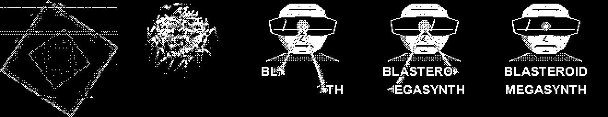
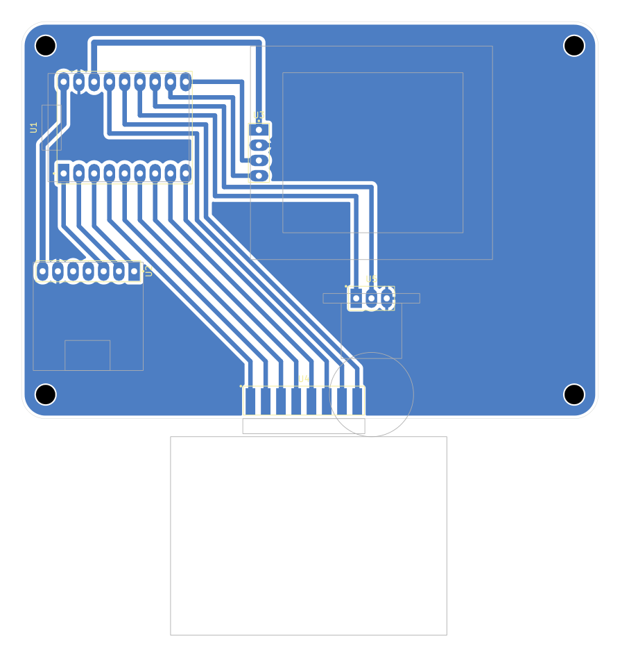

# BLASTEROID MEGASYNTH

**Experimental industrial ambient on an ESP32-S3.** A slow machine drone you build from layers, two robot mouths
(**SAM**, the 1982 Software Automatic Mouth, and the **Talkie** Speak & Spell LPC voice) that can freeze into drones,
get scratched on a knob and talk to each other, a box of industrial noises, and a huge reverb "space". It runs on a
4x4 keypad, one rotary pot, a 128x128 OLED and a small speaker.

At boot it plays a generative splash that's different every time: two random geometry scenes (string-art mandala,
polygon rings, flow-field particles, a rotating tunnel, a 3D Lissajous knot), glitch cuts. Then everything converges
into **the Blasteroid**: a cyborg cyclops in wraparound shades. His eye charges up, two lasers burn
**BLASTEROID / MEGASYNTH** in from opposite ends, SAM says the name, and Talkie answers "OPERATIONAL".



The board is a single-sided PCB designed to be **milled on a desktop CNC**. The modules plug into headers or edge
pads, so there's no SMD soldering.



## What's in here

| Folder | Contents |
|---|---|
| `firmware/blasteroid_megasynth/` | The Blasteroid Megasynth sketch (Arduino), with SAM's C core and the Talkie vocabularies bundled alongside |
| `firmware/keypad_bringup/` | Bring-up test: I2C scan, every key plays a note, pot = volume. Flash this first |
| `firmware/short_finder/` | Finds pins shorted to GND or to each other on a freshly milled board (pull-ups only, safe) |
| `hardware/kicad/` | KiCad project for the board (rev B: pot standing under the OLED), custom symbols + footprints |
| `hardware/cnc/` | Gerbers + drills, G-code for a Genmitsu Cubiko (GRBL), FlatCAM script, 1:1 fit-test print, cheat sheet |
| `tools/` | `splash_preview.py`: a Python mirror of the boot splash that renders storyboards (`python splash_preview.py <seed> <seconds...>`, needs numpy + Pillow) |

## Parts

| Ref | Part | Notes |
|---|---|---|
| U1 | ESP32-S3 **SuperMini** | 2x 1x9 female headers. Needs **PSRAM** (e.g. 4 MB flash / 2 MB PSRAM) |
| U2 | MAX98357A I2S amp breakout | 1x7 female header, VIN on 5 V, plus a small 4-8 ohm speaker |
| U3 | 1.5" 128x128 OLED, **SH1107**, I2C | 1x4 female header (VCC GND SCL SDA) |
| U4 | 4x4 tact keypad module (passive matrix, e.g. QYF-JP01) | hangs off the bottom edge; its right-angle pins lie on 8 edge pads |
| U5 | 10k rotary pot module (3 pins) | stands in 3 holes under the OLED, knob towards the keypad |
| | 100 x 70 mm single-sided copper clad | board is 96 x 66 mm, M3 holes |

## Pinout

| Function | GPIO |
|---|---|
| OLED SDA / SCL | 9 / 8 |
| Amp DIN / BCLK / LRC | 43 (TX) / 44 (RX) / 1 |
| Keypad rows R1-R4 / columns C1-C4 | 2 3 4 5 / 6 7 13 12 |
| Pot wiper / pot high leg | 10 / 11 (driven HIGH as the pot's supply), low leg to GND |

The amp uses the TX/RX pins, so **USB CDC On Boot must be Enabled** (serial goes over native USB).

## Build the firmware

1. Arduino IDE (or arduino-cli) with the **ESP32 core 3.x** and the **U8g2** library.
2. Board settings: **ESP32S3 Dev Module**, **USB CDC On Boot: Enabled**, **PSRAM: enabled**.
   arduino-cli FQBN: `esp32:esp32:esp32s3:CDCOnBoot=cdc,PSRAM=enabled`
3. Flash `keypad_bringup` first to check the keys, pot, OLED and speaker, then `blasteroid_megasynth`.

```
arduino-cli compile --fqbn esp32:esp32:esp32s3:CDCOnBoot=cdc,PSRAM=enabled firmware/blasteroid_megasynth
arduino-cli upload  --fqbn esp32:esp32:esp32s3:CDCOnBoot=cdc,PSRAM=enabled -p COMx firmware/blasteroid_megasynth
```

Tips:
- The OLED needs the `U8G2_SH1107_PIMORONI_128X128` constructor. The generic SH1107 one shifts the picture by 32 px.
- If the SuperMini sits silent after an upload, press RST. The auto-reset can leave it in the bootloader.
- If the knob works backwards, turn the pot module round. Swapping its outer legs reverses the direction.

## Playing it

```
[MODE ] [ pad 0 ] [ pad 1 ] [ pad 2 ]      left column: tap = quick action,
[FX   ] [ pad 3 ] [ pad 4 ] [ pad 5 ]      HOLD = the screen shows what the 12 pads do
[SEQ  ] [ pad 6 ] [ pad 7 ] [ pad 8 ]
[SHIFT] [ pad 9 ] [ pad 10] [ pad 11]
```

| Key | tap | hold + pad |
|---|---|---|
| MODE | next mode (HUM > SAM > TALK > MACH) | modes, volume, Talkie bank, **REPLAY** the boot film, SAM voice (ROBOT SAM GHOST DEEP) |
| FX | next voice FX | CLEAN ECHO RADIO GRAIN DEEP VOX CHOIR, momentary STUTTER / REVERSE / TAPE STOP / UNDERWATER, **INFINITE** (reverb freeze) |
| SEQ | REC on/off | PLAY, **CROSSTALK**, AUTO, BPM -/+, MUTATE, RANDOM machines (sparse > busy > factory), clears, SILENCE |
| SHIFT | PLAY/STOP | per mode: drone octave / brightness / LFO speed / detune; SAM words backwards; Talkie bends; machine mutes |

**The knob**
- **Knob alone:** the current voice FX's main control: pitch, echo feedback, radio tuning, grain density, depth, vocoder wet, choir breath.
- **SHIFT + knob = SCRATCH:** scrub through the current SAM or Talkie word like a record under your hand. It's silent while the knob is still.
- **FX + knob = SPACE:** from dry and close to a huge, long reverb.

**Modes**
- **HUM:** drone layers on/off: MAINS (transformer hum), SUB, PAD, CHOIR (morphing vowel), METAL (inharmonic FM girder), WIND, RADIO (shortwave whistle and crackle), PULSE (heartbeat). Also DRIFT (the chord wanders i-bVI-bIII-bVII), KEY -/+, and CHORD (fifth, minor7, sus2, minor9, void).
- **SAM:** 12 words (OHM, SILENCE, SIGNAL, MACHINE, BREATHE, ECHO, VOID, DRIFT, STATIC, RESONANCE, FREQUENCY, WE ARE LISTENING). Tap = say it, hold = **freeze** it into a granular drone.
- **TALK:** four Talkie banks: SIGNAL, NUMBERS (numbers station), ELEMENTS, MACHINE. Tap = say it, hold = freeze the mouth on one frame, humming in the drone's key.
- **MACH:** 12 industrial sounds: KLANK, PIPE, HAMMER, HISS, GEIGER, RELAY, SERVO, SONAR, CHAIN, DRIP, HORN, THUD. Hold = repeat.
- **CROSSTALK:** SAM and Talkie take turns, a word per bar, over whatever is playing.
- With REC on, voices and machines are quantized into the 16-step sequencer.

## Make the board

Single-sided, all copper on **B.Cu**, made for isolation milling. The Gerbers also work at a board house as a 1-layer board.
Full steps are in `hardware/cnc/CNC_CHEATSHEET.txt`: V-bit isolation, 1.0 mm drill, 2.0 mm drill, outline score.
The keypad's pins solder flat onto edge pads, and the pot stands in 3 holes.

> **Isolation gutters:** with a single 0.1 mm V-bit pass, several SuperMini pads stayed shorted to the ground pour.
> `load_and_mirror.tcl` now isolates with **3 passes** (about a 0.3 mm gutter). The ready-made
> `1_isolation_0.1vbit.nc` is the older single-pass file, so regenerate it with FlatCAM (set the path at the top of
> the script). After milling, meter every header pad to GND before soldering, or flash `short_finder` on a
> populated board.

Print `PRINT_1to1_fit_test.pdf` at 100% and check your modules against it before milling. The keypad and pot
outlines were measured from photos.

## Credits and license

- **SAM** (Software Automatic Mouth) by Mark Barton / Don't Ask Software (1982). C port by Sebastian Macke,
  ESP8266SAM by Earle F. Philhower III.
- **Talkie** LPC speech by Peter Knight, extended by Armin Joachimsmeyer (vocabulary data bundled).
- **U8g2** by olikraus; **esp-dsp** and the ESP32 Arduino core by Espressif.
- Co-created by **Mark Hellar** and **Claude** (Anthropic). PCB milled and soldered by Mark Hellar.

Licensed under the **GNU GPL v3** (see `LICENSE`), matching the bundled SAM and Talkie code.
